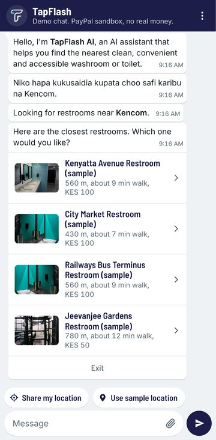
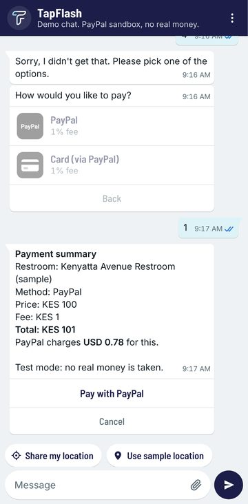
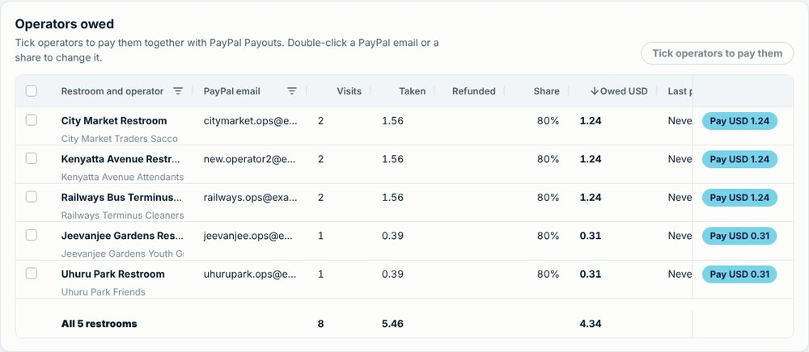
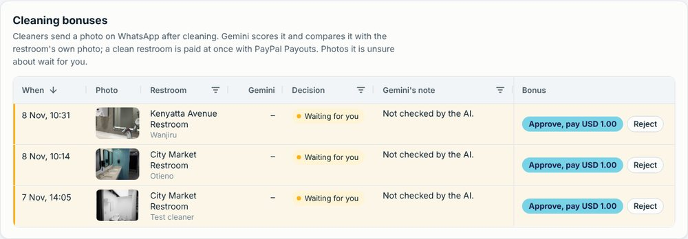
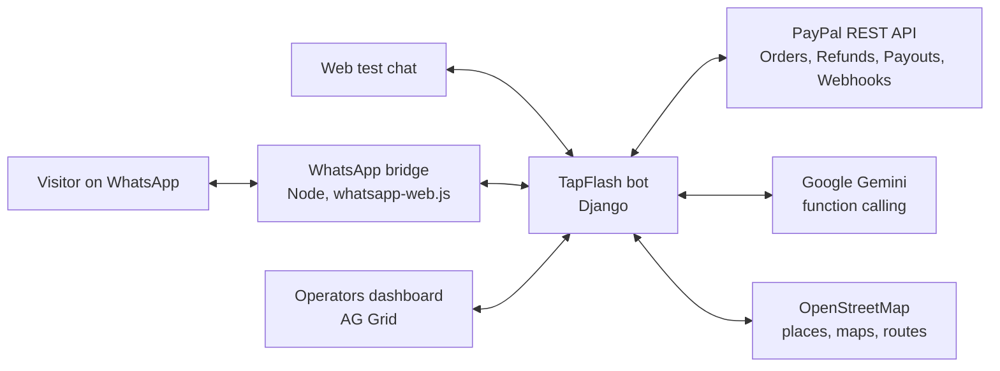

# TapFlash

**Find a clean public restroom in Nairobi on WhatsApp, pay with PayPal, and walk in with a code.**
An AI concierge understands English, Swahili and Sheng. When a visit goes wrong, an AI review refunds it
through PayPal, inside limits the code enforces. Operators see every visit on a live dashboard and are
paid their share with PayPal Payouts, and cleaners are paid a bonus the moment Gemini approves the photo
of the restroom they just cleaned.

Built for the [PayPal AI Hackathon](https://paypalaihackathon.devpost.com/) with the PayPal REST APIs
(sandbox) and Google Gemini.

| | |
|---|---|
| **Problem** | In Nairobi, a clean public restroom that is open when you get there is hard to find, and the operators and cleaners who keep them are paid in cash, late or not at all. |
| **Who** | Visitors, parents with small children and people with disabilities on one side; restroom operators and cleaners on the other. |
| **Why PayPal + AI** | Gemini understands what people write and what a photo shows; PayPal moves the money: checkout, refunds the AI may give within code-enforced limits, and payouts to operators and to cleaners the moment their work is approved. |

## See it

| Ask in Swahili, get four open restrooms | Pay with PayPal (sandbox) | Attendant scans the code at the door |
|---|---|---|
|  |  |   |

The operators' dashboard (AG Grid): what each operator is owed, paid with PayPal Payouts, and cleaning
photos scored by Gemini with their bonus.




## For judges

**Start here: <https://hackathon.withpdf.com/judges/>**: one page with the three steps, one-click entry to the
dashboard and the door check, and the PayPal sandbox buyer login.

**The 60-second path:** open <https://hackathon.withpdf.com/>, type `Niko Kencom, nataka choo safi`, pick a
restroom, Pay, PayPal, and log in with the sandbox buyer from the Devpost testing instructions. Back in the
chat, write `The door was locked`: Gemini refunds you through PayPal. Then open `/ops/` (judge login) to see
the visit, the AI's review and the refund, and pay the operator with PayPal Payouts.


- **Hosted demo:** <https://hackathon.withpdf.com/>: the same bot as on WhatsApp, in a web chat, so nothing
  needs installing. PayPal is in **sandbox**: pay with the sandbox buyer account given in the Devpost
  testing instructions (or any sandbox personal account of yours).
- **Operators' dashboard:** <https://hackathon.withpdf.com/ops/> (AG Grid), with the login in the Devpost
  testing instructions.
- **Door check (the attendant's phone):** <https://hackathon.withpdf.com/gate/>, same login: scan the access
  QR code from the chat, or type its 6-digit code.
- **To try a cleaning bonus** in the web chat: ⋮ menu > *Send a photo (cleaners)*: the test chat's number
  is registered as a cleaner on the demo. A clean photo of the demo restroom is paid at once; a photo of
  another restroom goes to staff (Gemini compares it with the restroom's own photo): approve it on `/ops/`
  to see the PayPal payout. The web chat sends a fixed test number, so on the demo anyone can act as that
  cleaner; on WhatsApp the number comes from WhatsApp.
- **Run it yourself:** see [Try it](#try-it). Without keys everything still runs, with payments and AI
  simulated.

## How PayPal is used

| What | PayPal API | Code |
|---|---|---|
| A payment link in the chat (PayPal account, or a card as a guest) with no shipping and *Pay now* | Orders v2: create order, `payment_source.paypal.experience_context` | [payments/paypal.py](django/payments/paypal.py), [payments/checkout.py](django/payments/checkout.py) |
| Taking the money once, whichever comes first: the return page, the webhook or *I have paid* | Orders v2: capture, with `PayPal-Request-Id` so a retry never charges twice | [payments/checkout.py](django/payments/checkout.py) |
| Knowing a buyer paid even if they close the page | Webhooks (`CHECKOUT.ORDER.APPROVED`), checked with `verify-webhook-signature` | [channels/paypal_views.py](django/channels/paypal_views.py) |
| A payment PayPal later denies or reverses: the access code stops working and the money comes off the operator's next payout | Webhooks (`PAYMENT.CAPTURE.DENIED`, `PAYMENT.CAPTURE.REVERSED`) | [payments/webhooks.py](django/payments/webhooks.py) |
| Refunding a failed visit, by the AI within its rules or by staff from the dashboard | Payments v2: refund a capture, with a request id so a retry never refunds twice | [payments/refunds.py](django/payments/refunds.py) |
| A cleaning bonus the moment a cleaner's photo is approved (by Gemini, or by staff), and whether it reached them | Payouts v1, one batch per approved check; item status (`PAYMENT.PAYOUTS-ITEM.*`) | [ops/cleaning.py](django/ops/cleaning.py) |
| Paying operators their share, never twice (the payout is saved and the restroom locked before PayPal is called; an unanswered payout is resent with the same request id) | Payouts v1, and `PAYMENT.PAYOUTSBATCH.*` webhooks for the result | [ops/payouts.py](django/ops/payouts.py) |

The chat never sees card details. The web chat counts as one fixed test number (a browser can't claim
another), one address can send at most 40 messages a minute, and the door-check login locks for 15 minutes
after 8 wrong passwords. A payment the chat has given up on (the user chose another way to pay,
or the chat timed out) is never captured, so an approval that arrives late takes no money.

## How AI is used

Google Gemini (`gemini-3.8-flash` on the free tier, falling back to `gemini-3.5-flash-lite` when busy),
called over REST with **function calling**: each call must pick exactly one action, and the bot's own
code carries it out.

- **Concierge** ([bot/ai/concierge.py](django/bot/ai/concierge.py)): any message the menus can't read goes to
  Gemini, which chooses one of six actions: set a need, search near a place, pick a choice on screen,
  answer a question from the facts given, report a problem, or ask again. Place names are found on
  OpenStreetMap (Nominatim) inside Nairobi ([bot/ai/places.py](django/bot/ai/places.py)).
- **Problem triage** ([bot/ai/triage.py](django/bot/ai/triage.py)): Gemini reads a report about a paid
  visit and returns a category, a severity from 1 to 5, a refund advice (full, partial or none), a reply
  in the user's language and a note for the operator.
- **Cleaning check** ([bot/ai/cleaning.py](django/bot/ai/cleaning.py)): Gemini looks at a cleaner's photo
  (vision) and returns whether it shows a restroom, a cleanliness score, what is left to do and a reply.
  An approved photo also tells visitors: the restroom list says *cleaned 25 min ago*, and asking for the
  cleanest puts restrooms cleaned in the last 6 hours first ([restrooms/finder.py](django/restrooms/finder.py)).
- **Rules the AI can't bend** ([payments/refunds.py](django/payments/refunds.py)): money goes back only for a
  paid visit that was not refunded yet, reported within `REFUND_WINDOW_MINUTES` (default 120), and at most `MAX_REFUNDS_PER_DAY`
  (default 1) per person per day (counted by chat, phone number and PayPal account). Everything else goes to staff with the AI's note.
  A full refund ends the access pass. The report is passed to the model as data, never as instructions.
- **Guardrails**: the model never sees phone numbers, links in its text are removed, and without a key
  the bot simply runs on its menus.

## Why

Nairobi's 138 city-owned public toilets were found "in a very unhygienic, barely functioning state"; where
private operators took them over, use rose to 500 to 1,000 visitors a day per toilet
([World Bank WSP, 2004](https://bdd.pseau.org/outils/ouvrages/wsp_management_public_toilets_nairobi.pdf)).
In January 2026 the US CDC reported that badly cleaned public toilets in Kenya worsen diarrhoeal illness and
outbreaks of cholera and mpox. The causes were high turnover and low morale among cleaners, and skipped
disinfection. What fixed it was routine checking with feedback
([CDC](https://www.cdc.gov/global-health/impact/clean-public-toilets-in-kenya.html)).

TapFlash does that checking with a photo and Gemini, pays the cleaner at once with PayPal Payouts, and shows
visitors "cleaned 25 min ago" before they pay. The search, the payment and the door code all happen in
WhatsApp, the app people already use.

## What a visitor does

1. Says *hi* on WhatsApp, or writes what they need in their own words:
   *"Nataka choo safi karibu na Kencom"* (I want a clean toilet near Kencom).
2. Picks a need: the most clean, the nearest, step-free, a toilet for the disabled, or baby changing.
3. Shares their location, or names a place. The four nearest matching restrooms come back with a photo,
   distance, price and opening hours. Restrooms that will be closed on arrival are left out.
4. Pays. Card and PayPal open **PayPal Checkout**; the KES price is charged in US dollars.
   M-Pesa and Airtel Money are simulated in this version.
5. As soon as PayPal confirms, the chat sends a receipt QR code, a walking route map and an
   **access code** (number and QR code) that opens the restroom.
6. Something wrong? They describe it. **Gemini reviews the report** and, if the visit failed, the money
   goes back through the **PayPal Refunds API**, within the rules below.

Operators open `/ops/` (an **AG Grid** dashboard), see what they are owed and press **Pay**: their share
of every paid visit, minus refunds, goes to their PayPal account through **PayPal Payouts**. Staff tick
several operators and pay them in one click (each gets its own PayPal payout), fix a PayPal email or a share right in the grid, add cleaners and door
attendants (with their logins) in the People section, and watch new
payments, refunds and payout statuses flash in as they happen (row ids, cell flashing, a pinned totals
row, floating filters, CSV export and each viewer's saved column layout; AG Grid Community only). Reports the AI
left for staff get a **Refund** button there, and the user is told in the chat.

**The attendant checks visitors in at the door.** On their phone, the restroom attendant opens `/gate/`
(their own login, one restroom) and scans the visitor's access QR code with the camera, or types the
6-digit code. The server answers **Let them in** only for a paid, unrefunded pass for this restroom that is
still valid and was never used: each pass lets one person in once, so a shared screenshot fails the second
time. The visitor gets "you're checked in" in the chat, entrances appear live on `/ops/`, and a visitor who
was let in can't get an automatic full refund for "the door was locked" (staff decide)
([ops/gate.py](django/ops/gate.py)).

**Cleaners are paid when the job is approved.** A cleaner (added on `/ops/` > People with their WhatsApp number
and PayPal email) sends a photo of the restroom they just cleaned. **Gemini scores it** from 1 to 5, and a
clean restroom (4 or 5) is **paid a bonus at once with PayPal Payouts**; the cleaner gets the PayPal
reference in the chat, and the dashboard shows whether the money reached them (sent, not claimed yet,
returned). Gemini also compares the photo with the restroom's own photo: a photo that doesn't look like
this restroom, or a 3, waits for staff on `/ops/` (approve and pay with one click), and a dirty photo gets a
list of what is left to do. The code, not the model, keeps the limits: an exact copy of an earlier photo is
refused, one bonus every 4 hours, three a day ([ops/cleaning.py](django/ops/cleaning.py)). A re-taken photo
of a clean room can still pass, which is why the limits and the supervisor review exist.

## How it fits together



- The conversation runs in Django ([django/bot/engine.py](django/bot/engine.py)), one locked turn per
  user, so two messages never race.
- Replies that happen later (the receipt after paying on PayPal's page) wait in an outbox that the web
  chat and the WhatsApp bridge collect ([django/bot/outbox.py](django/bot/outbox.py)).
- The Meta WhatsApp Cloud API is supported too ([django/channels/cloud_api.py](django/channels/cloud_api.py)).

## Try it

### On your computer

Needs Python 3.11 or newer.

```bash
cd django
python -m venv .venv
.venv/Scripts/python -m pip install -r requirements.txt      # on macOS or Linux: .venv/bin/python
cp .env.example .env
```

In `.env`, set `DEBUG=true` and add your keys (all free):

- `PAYPAL_CLIENT_ID` and `PAYPAL_CLIENT_SECRET`: [developer.paypal.com](https://developer.paypal.com/) >
  Apps & Credentials > Sandbox > create an app.
- `GEMINI_API_KEY`: [aistudio.google.com](https://aistudio.google.com/) > Get API key.
- `PUBLIC_URL=http://127.0.0.1:8000`, so PayPal can send buyers back.

Then:

```bash
.venv/Scripts/python manage.py migrate
.venv/Scripts/python manage.py seed_demo          # sample Nairobi restrooms and a day of visits
.venv/Scripts/python manage.py createsuperuser    # for /ops/ and /admin/
.venv/Scripts/python manage.py runserver
```

- Chat: <http://127.0.0.1:8000/>. Share the sample location (Kenyatta Avenue) or write a Nairobi place.
- Pay with card or PayPal and log in with one of your **sandbox personal accounts**
  (developer.paypal.com > Testing Tools > Sandbox Accounts).
- Operators: <http://127.0.0.1:8000/ops/>.

Without PayPal keys, card and PayPal payments are simulated; without a Gemini key, the bot uses its menus.

**Try a cleaning bonus:** on `/ops/` > People, add a cleaner with the test chat's number `+254712345678`, a restroom
and a sandbox personal account's email. In the chat, open the ⋮ menu > *Send a photo (cleaners)*.

**Webhooks** (on a server with a public `https://` address): developer.paypal.com > your sandbox app >
Webhooks > Add webhook, URL `https://<your server>/paypal/webhook`, with the events
`CHECKOUT.ORDER.APPROVED`, `PAYMENT.CAPTURE.DENIED`, `PAYMENT.CAPTURE.REVERSED`, `PAYMENT.CAPTURE.REFUNDED`,
`PAYMENT.PAYOUTSBATCH.SUCCESS`, `PAYMENT.PAYOUTSBATCH.DENIED`, `PAYMENT.PAYOUTSBATCH.PROCESSING`,
`PAYMENT.PAYOUTS-ITEM.SUCCEEDED`, `PAYMENT.PAYOUTS-ITEM.UNCLAIMED`, `PAYMENT.PAYOUTS-ITEM.RETURNED` and
`PAYMENT.PAYOUTS-ITEM.FAILED`. Put the
webhook's ID in `PAYPAL_WEBHOOK_ID`. Every call is checked with PayPal (`verify-webhook-signature`) before
anything changes; without the ID, webhooks are refused and the chat still works through the return page.

### On WhatsApp

Two ways to connect the same bot to WhatsApp:

- **Official WhatsApp Cloud API** (for production): set `WHATSAPP_TOKEN`, `WHATSAPP_PHONE_NUMBER_ID`,
  `WHATSAPP_VERIFY_TOKEN` and `WHATSAPP_APP_SECRET`, and point Meta's webhook at `/webhook`
  ([channels/cloud_api.py](django/channels/cloud_api.py)). Text, locations, menus, pictures and cleaners'
  photos all work.
- **QR-code bridge** (quick demos, used for our demo number): a Node.js bridge built on the open source
  [whatsapp-web.js](https://github.com/pedroslopez/whatsapp-web.js), which links to WhatsApp like WhatsApp Web
  does. It is unofficial, so use a number set aside for the bot. On a computer with Node.js 20.12 or newer:
  `npm install`, set `REMOTE_BOT_URL` and `REMOTE_BOT_TOKEN` in `.env`, then `npm run bridge` and scan the QR
  code with the bot's phone. Details: [docs/whatsapp-bot-node.md](docs/whatsapp-bot-node.md).

Judges don't need WhatsApp: the web chat runs the same bot.

## Tests

```bash
cd django && python manage.py test     # 358 tests: the bot, PayPal, webhooks, AI, refunds and payouts
npm test                                              # the WhatsApp bridge
```

PayPal and Gemini are replaced by fakes in the tests, so they run offline.

## Built during the hackathon

TapFlash's first line was written on 11 October 2026, after the hackathon opened. Since then:
the conversation, restroom search and access passes; the Django rebuild with WhatsApp Cloud API support;
then real PayPal Checkout, webhooks, refunds and payouts; the Gemini concierge and refund triage; the
operators' dashboard; and cleaning bonuses paid on approval.

## Next

- Real M-Pesa (Safaricom Daraja) next to PayPal.
- Saving PayPal for one-tap repeat visits, with spending limits the user sets.

## Credits and license

[MIT](LICENSE). Maps and place search: © [OpenStreetMap](https://www.openstreetmap.org/copyright)
contributors. Walking routes: [OSRM](https://project-osrm.org/). Tables: [AG Grid Community](https://www.ag-grid.com/) (MIT).
Sample restroom photos: Wikimedia Commons, see
[django/restrooms/demo_photos/CREDITS.txt](django/restrooms/demo_photos/CREDITS.txt).
